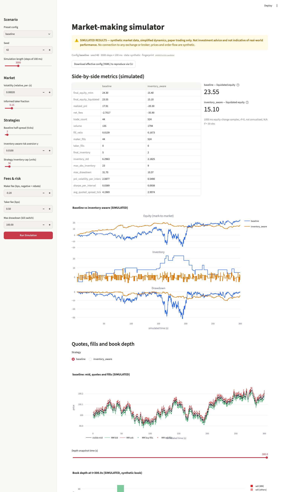
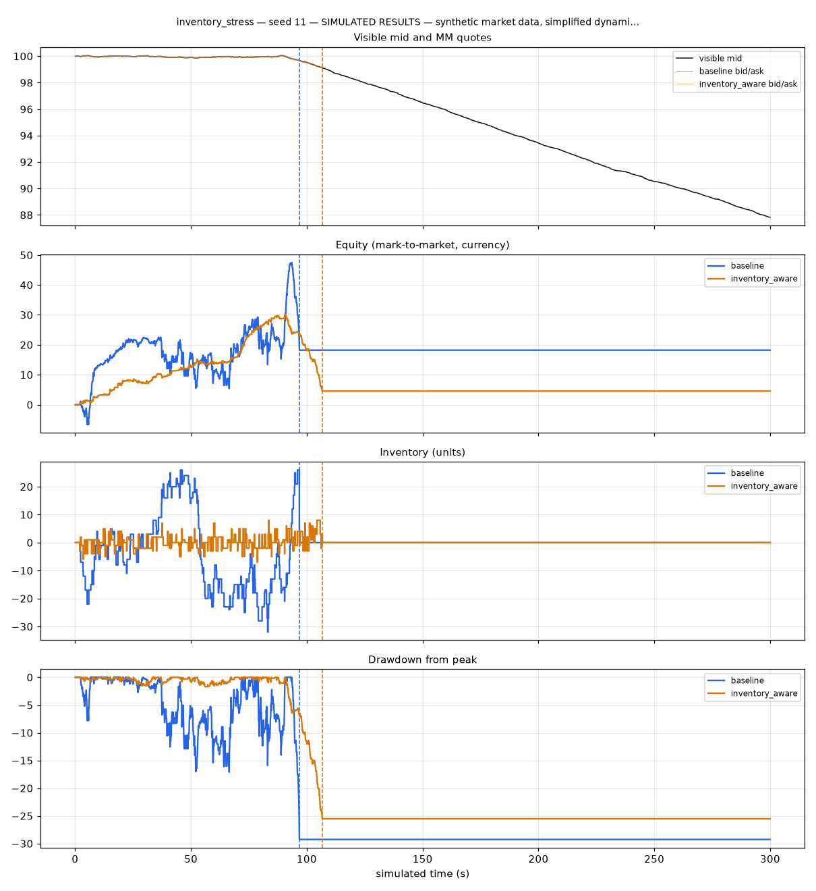

# Algorithmic Market-Making Simulator

A **deterministic, offline, paper-trading simulation** of electronic market making on a
limit order book. It includes a price-time-priority matching engine on integer ticks, a
seeded synthetic market (with regimes, noise traders and informed traders), a
discrete-event clock with order and cancel latency, two quoting strategies compared on
the *same* event stream, risk controls with a kill switch, full P&L accounting, a
Streamlit dashboard, and an optional C++20 matching engine that is verified to match
the Python one exactly.

> **All results are SIMULATED.** Prices and order flow are synthetic, and the dynamics
> are deliberately simplified. Nothing here connects to an exchange or broker, places
> real orders, or needs API keys. This is not trading advice, and nothing in it says
> anything about real-world profitability.



---

## One-minute demo

```bash
git clone https://github.com/<you>/algorithmic-market-making-simulator.git
cd algorithmic-market-making-simulator
uv sync                                    # installs the locked environment (Python 3.12)
uv run python scripts/run_demo.py          # 3 scenarios -> runs/demo/... (CSV, JSON, HTML, PNG)
uv run streamlit run app/dashboard.py      # interactive dashboard at http://localhost:8501
```

In the dashboard, pick the **inventory_stress** preset and press **Run Simulation**.
You'll see both strategies get filled, inventory build up as the trend runs over their
quotes, and the drawdown kill switch trip. The dashed line marks the kill: quotes are
cancelled and the position is flattened.

## Setup

Requires [uv](https://docs.astral.sh/uv/). uv installs Python 3.12 itself if it's missing.

| | macOS / Linux | Windows (PowerShell) |
|---|---|---|
| Install uv | `brew install uv` or `curl -LsSf https://astral.sh/uv/install.sh \| sh` | `powershell -c "irm https://astral.sh/uv/install.ps1 \| iex"` |
| Install deps | `uv sync` | `uv sync` |
| Tests | `uv run pytest` | `uv run pytest` |
| Lint / types | `uv run ruff check .` · `uv run mypy` | same |

All dependencies are pinned in `uv.lock`. After `uv sync`, everything runs offline.

## Commands

```bash
# Single run, both strategies on the same seeded stream; prints a metrics table and
# writes timestamped artifacts
uv run python -m marketmaker.simulation --config examples/baseline.yaml --seed 42 --output runs/baseline
uv run mmsim --config examples/inventory_stress.yaml          # console-script equivalent
uv run mmsim --config examples/volatile_market.yaml --strategy inventory_aware --steps 2000

# Multi-seed x multi-regime comparison with paired t-tests
uv run mmsim-experiments --config examples/baseline.yaml --seeds 1 2 3 4 5 6 7 8 9 10 --output runs/suite.csv

# Demo scenarios + charts (add --readme to refresh docs/images)
uv run python scripts/run_demo.py

# Dashboard
uv run streamlit run app/dashboard.py

# Optional C++ engine (needs CMake >= 3.20 and a C++20 compiler; Catch2 is fetched at configure time)
cmake -S cpp -B cpp/build -DCMAKE_BUILD_TYPE=Release && cmake --build cpp/build -j
ctest --test-dir cpp/build --output-on-failure
uv run pytest tests/test_cpp_equivalence.py
uv run python scripts/benchmark_cpp.py --steps 20000 --reps 7
```

The CLI and the dashboard both call `marketmaker.simulation.run_comparison`, so the same
config and seed give identical numbers in both. The dashboard shows the config fingerprint
and has a **Download effective config** button, so you can rerun any dashboard result with
`mmsim --config <file>`. `tests/test_integration.py::test_cli_matches_engine` checks this.

### Run artifacts

Each run writes to `<output>/<UTC timestamp>_seed<seed>/`:

| File | Contents |
|---|---|
| `manifest.json` | full config, seed, config fingerprint, data source, versions, `"simulated": true`, disclaimer |
| `metrics.json`, `comparison.csv` | all metrics per strategy |
| `<strategy>_fills.csv` | every fill: time, side, price, qty, maker/taker, fee, mid at fill, inventory after |
| `<strategy>_orders.csv` | message log: submit, ack, exchange/risk reject, cancel request/ack/too-late, fill, flatten |
| `<strategy>_timeseries.csv` | per-step mid, own quotes, inventory, cash, fees, realized/unrealized P&L, equity, drawdown |
| `<strategy>_quotes.csv`, `<strategy>_depth.csv` | strategy targets (reservation, half-spread, σ̂) and book-depth snapshots |
| `market_fundamental.csv` | the latent price path (for analysis only; strategies never see it) |

---

## Market microstructure in brief

* A **limit order** rests on the book at a stated price and adds liquidity (*maker*). A
  **market order** executes right away against resting orders and removes liquidity
  (*taker*). Exchanges usually charge takers a fee and may pay makers a **rebate**.
* The **order book** holds the resting bids and asks. **Price-time priority** means a
  better price executes first, and at the same price the earlier order executes first (FIFO).
* A **market maker** quotes both a bid and an ask. It earns the spread when both sides fill.
  The main risks are **inventory risk** (holding a position while the price moves) and
  **adverse selection** (being filled mostly by better-informed traders right before the
  price moves against you).

## Architecture

```
src/marketmaker/
  models.py       Order, Trade, Fill, Quote, MarketEvent, Position, Ledger, enums (event priorities)
  orderbook.py    price-time-priority book: sorted price levels + FIFO deques, integer ticks
  exchange.py     book + fee model + per-owner ledgers; fills both sides of every trade
  marketdata.py   seeded synthetic stream: GBM/OU fundamental, LP limits/cancels, noise + informed takers, regimes, CSV adapter
  strategies.py   MarketView (what a strategy may see), fixed-spread and inventory-aware strategies, EWMA vol
  agent.py        order management shared by strategies: latency, min quote life, throttle, risk checks, audit log
  risk.py         pre-trade limits, drawdown monitor, kill switch
  simulation.py   discrete-event engine (heap by time, priority, seq), RunResult, run_comparison, CLI
  metrics.py      P&L, drawdown, Sharpe (with stated assumptions), spread capture, markouts, adverse selection
  experiments.py  artifact export, multi-seed/regime suites, paired t-tests
  plots.py        Plotly (dashboard, self-contained HTML) and matplotlib (PNG) charts
  cpp_bridge.py   optional: workload export, Python reference output, C++ subprocess runner
app/dashboard.py  Streamlit UI
cpp/              optional C++20 order book + CLI (CMake, Catch2)
examples/         baseline.yaml, volatile_market.yaml, inventory_stress.yaml
scripts/          run_demo.py, benchmark_cpp.py
tests/            unit, property (Hypothesis), integration, reproducibility, dashboard, C++ equivalence
```

### Event model and no look-ahead

There is one priority queue, keyed by `(time_ms, priority, insertion_seq)`. At equal
timestamps, events run in this order: **agent cancels → agent orders → LP cancels → LP
limits → taker market orders → strategy wake-up → accounting sample**. A strategy that
wakes at *t* sees the book as of *t*. Its messages reach the exchange at
*t + latency*, so a quote can still be filled while its cancel is in flight (this shows
up as `cancels_too_late`). Strategies see only the visible book (excluding their own
quotes), their own inventory, and their own volatility estimate. They never see the
latent fundamental price or future events.
`test_no_lookahead_future_events_do_not_change_past` deletes every event after *T* and
checks that every decision before *T* is unchanged.

Acks and fills reach the agent with zero latency. This simplification is documented
below.

### Synthetic market (simplified!)

* **Fundamental**: GBM, `S ← S·exp((μ − σ²/2)Δt + σ√Δt·Z)`, or arithmetic OU around the
  start price. σ is the relative volatility per √second.
* **Liquidity providers**: Poisson arrivals per side at geometric distances from the
  fundamental. Orders are cancelled at random, when they go stale (the fundamental
  crosses them), or when they drift too far from it.
* **Takers**: Poisson market orders. A configurable *informed fraction* trades in the
  direction of the fundamental's move over the next `informed_horizon_steps`. This is
  what creates adverse selection. The rest are noise traders with configurable buy/sell
  imbalance.
* **Regimes**: `baseline`, `low_liquidity` (0.3× LP arrivals, 2× cancels),
  `volatility_spike` (4× σ, thinner book, 1.5× flow) and `trend` (drift plus imbalanced
  flow). They can be combined over fractions of a run.
* Independent RNG streams (`SeedSequence.spawn`) for price, LP and taker flow, so changing
  LP parameters doesn't change the price path.
* **CSV adapter**: `market.price_csv` replaces the synthetic fundamental with a local
  series of mid prices (`mid` or `close` column; schema validated). The **order book is
  still synthetic** in that case, and the data source is labelled that way in every
  artifact. It is *not* historical level-2 data.

## Strategies

Both strategies use the same agent (latency, a 200 ms minimum quote lifetime, a
20 msg/s throttle, a requote threshold, risk checks and inventory caps). The comparison
therefore isolates the pricing logic. All quotes are post-only and are clamped so they
never cross the visible book.

**1. Baseline: fixed spread.** `bid = ⌊mid − h⌋`, `ask = ⌈mid + h⌉`, with `h` =
`half_spread_ticks`. It stops quoting the side that would push |inventory| past
`max_inventory`.

**2. Inventory-aware (inspired by Avellaneda & Stoikov, 2008):**

```
reservation price  r = mid − q · γ · σ² · τ
total spread       δ = γ · σ² · τ + (2/γ) · ln(1 + γ/k)
bid = ⌊r − δ/2⌋,  ask = ⌈r + δ/2⌉,  half-spread clamped to [min_half_spread_ticks, max_spread_ticks/2]
```

`q` = inventory (units), `γ` = risk aversion, `σ` = online EWMA estimate of the observed
mid's volatility (ticks/√s), `τ` = risk horizon (s), and `k` = order-arrival decay.
**Deviations from the paper**, so this is *not* an exact implementation:

* τ is a fixed rolling horizon, not time-to-close `T − t`.
* σ is estimated online from observed mids.
* k is a constant, not fitted to fills.
* Prices are rounded outward to ticks.
* Quotes are clamped to stay passive, and the maximum width is enforced after clamping.
* The same hard inventory caps as the baseline apply.

## Risk and accounting conventions

* **Pre-trade checks** (every order): `qty ≤ max_order_qty`; worst-case position
  (inventory plus *all* open same-side quantity, including in-flight and pending-cancel
  orders) within `±position_limit`; worst-case notional ≤ `max_notional`.
* **Kill switch**: trips when peak-to-trough equity drawdown exceeds `max_drawdown` (or
  the position limit is breached). It cancels all quotes immediately, bypassing the
  throttle and minimum quote lifetime, and blocks new orders for the rest of the run.
  With `risk.flatten_on_kill: true` it also sends one taker market order to close the
  position. Without it, the position is held and marked to market. This is why some
  runs show losses far beyond the drawdown limit after a trip.
* **Fees**: basis points of notional per fill, where notional = `price_ticks × qty ×
  tick_value` and `tick_value = tick_size × contract_multiplier`. A negative maker fee is
  a rebate.
* **Cash** is tracked as an exact integer of tick-units. **Realized P&L** uses the
  average-cost method (position flips are handled). **Unrealized P&L** =
  `q × (mark − avg_cost) × tick_value`.
* **Mark-to-market**: visible mid *excluding own quotes*. If a side is empty, the last
  valid mid is used.
* **Equity** = cash + q·mark·tick_value − fees = realized + unrealized − fees. This
  identity is property-tested and checked at every sample of every integration run.
* **End-of-run liquidation**: any remaining inventory is assumed closed at
  `mid ∓ liquidation_penalty_ticks` and pays the taker fee (`final_equity_liquidated`).

## Configuration schema

YAML files are validated by Pydantic. Unknown keys and invalid values are rejected. The
main fields are below; see [`src/marketmaker/config.py`](src/marketmaker/config.py) for
the full list with defaults.

```yaml
name: baseline
seed: 42
steps: 3000            # number of steps
step_ms: 100           # simulated ms per step
market:
  initial_price: 100.0
  process: gbm         # gbm | ou
  volatility: 0.0002   # relative σ per sqrt(second)
  drift_per_sec: 0.0
  ou_kappa: 0.02
  lp_arrival_rate: 3.0         # LP orders per side per step
  lp_max_levels: 8
  lp_cancel_prob: 0.04         # per resting LP order per step
  market_order_rate: 0.5       # taker orders per step
  market_order_max_size: 8
  informed_fraction: 0.15
  informed_horizon_steps: 10
  flow_imbalance: 0.0          # P(buy) - 0.5 for noise takers
  regimes:                     # later segments override earlier ones
    - {regime: baseline, start_frac: 0.0, end_frac: 1.0}
    - {regime: volatility_spike, start_frac: 0.4, end_frac: 0.6, volatility_multiplier: 3}
  price_csv: null              # optional local CSV of mid prices
exchange:
  tick_size: 0.01
  contract_multiplier: 10      # tick_value = 0.10
  fees: {maker_fee_bps: -0.2, taker_fee_bps: 0.5}
  order_latency_ms: 20
  cancel_latency_ms: 20
  self_trade_prevention: true
risk: {position_limit: 100, max_order_qty: 20, max_notional: 100000, max_drawdown: 100, flatten_on_kill: false}
strategies:
  baseline: {quote_size: 5, max_inventory: 50, half_spread_ticks: 2,
             decision_interval_ms: 100, min_quote_lifetime_ms: 200,
             max_messages_per_sec: 20, requote_threshold_ticks: 1}
  inventory_aware: {quote_size: 5, max_inventory: 50, gamma: 0.01, horizon_sec: 10, k: 1.5,
                    min_half_spread_ticks: 1, max_spread_ticks: 20, vol_halflife_sec: 30}
liquidation_penalty_ticks: 1.0
markout_horizon_ms: 1000
sharpe_sample_ms: 1000
```

---

## Sample results (simulated, generated by running the code)

Produced by `uv run python scripts/run_demo.py` and the `mmsim-experiments` command above,
on an Apple-silicon Mac with Python 3.12.16. Rerunning with the same config and seed gives
exactly these numbers. Currency units are arbitrary (`tick_value = 0.10`).

**Demo scenarios** (5–6.7 simulated minutes each):

| Scenario (seed) | Strategy | Liquidated equity | Trades | Max DD | Inventory σ | Kill switch |
|---|---|---:|---:|---:|---:|---|
| baseline (42) | baseline | 23.55 | 44 | 31.70 | 6.30 | no |
| | inventory_aware | 15.10 | 524 | 10.37 | 2.18 | no |
| volatile_market (7) | baseline | −260.60 | 258 | 595.00 | 16.85 | yes @ 165.2 s |
| | inventory_aware | −157.22 | 696 | 166.23 | 2.36 | yes @ 188.2 s |
| inventory_stress (11) | baseline | 18.22 | 264 | 29.26 | 8.37 | yes @ 96.7 s (flattened) |
| | inventory_aware | 4.55 | 272 | 25.52 | 1.59 | yes @ 106.6 s (flattened) |



**10 seeds × 4 regimes** (baseline.yaml, 3000 steps each, means over seeds 1–10, paired
t-test on liquidated equity):

| Regime | Baseline equity | Inv.-aware equity | Diff | p-value | Baseline / IA max DD | Baseline / IA inventory σ |
|---|---:|---:|---:|---:|---:|---:|
| baseline | 2.41 | 26.99 | +24.57 | 0.17 | 57.4 / 4.3 | 10.8 / 2.1 |
| low_liquidity | 215.74 | 67.71 | −148.03 | 3.5e−5 | 61.4 / 9.6 | 19.0 / 2.8 |
| volatility_spike | −35.57 | −119.14 | −83.58 | 0.59 | 679.9 / 133.1 | 12.6 / 1.8 |
| trend | −3067.67 | −336.18 | +2731.49 | 1.5e−8 | 3065.0 / 336.2 | 3.7 / 2.2 |

**What these simulated numbers show, and what they don't:**

* The inventory-aware quoter consistently holds **much smaller inventory** and has
  **much smaller drawdowns** in every regime. That is what the reservation-price skew is
  designed to do.
* It does **not** reliably earn more. In the thin `low_liquidity` book, the wider fixed
  spread of the baseline earned significantly more on these seeds. The `baseline` and
  `volatility_spike` differences are not statistically significant over 10 seeds.
* In `trend`, both strategies hit the kill switch (`baseline.yaml` doesn't flatten on
  kill). The baseline was holding a large position when it tripped, and that position
  kept losing as the trend continued. Most of the gap comes from that.
* All of this depends on the simplified synthetic market and the chosen parameters. It
  is a property of this model, not a claim about real markets.

## C++ matching engine (optional)

The `cpp/` folder holds a C++20 port of the order book: `std::map` price levels with
`std::list` FIFO queues and an `unordered_map` index for O(1) cancel lookup. A CLI replays
a text command stream through it. It is isolated and the simulator doesn't depend on it.
The Python package installs and runs without a compiler.

* **Equivalence**: `tests/test_cpp_equivalence.py` replays 9 workloads (3 seeds × 3
  regimes, about 15k commands each). Each workload is built from the synthetic stream plus
  injected post-only crosses, duplicate IDs and self-trades. The Python and C++ outputs
  must be **byte-identical**: every trade ID, price, quantity, maker/taker ID, reject
  reason, STP cancel and cancel ack.
* **Profile first**: in a full 20,000-step simulation (318k events, about 1.9 s under
  cProfile), the order-book methods take roughly 25% of the time. The event heap, the
  agent and the accounting take the rest.
* **Benchmark** (`scripts/benchmark_cpp.py --steps 20000 --reps 7`): 260,881 identical
  commands, outputs checked identical before timing. Only the submit/cancel loop is timed
  on a fresh book, with parsing and I/O excluded on both sides, and the median of 7 reps is
  reported. C++ was built in CMake Release with Apple clang 17. Measured on Apple silicon
  (arm64, macOS):

  | Implementation | ns / command |
  |---|---:|
  | Python 3.12 `OrderBook` | 640 |
  | C++20 `mm::OrderBook` | 77 |

  That is about 8.3× for the **matching component alone**. Because matching is only about
  a quarter of total simulation time, swapping it in would speed up end-to-end runs by at
  most about 1.3× (Amdahl's law). So the simulator keeps the Python reference engine, and
  the C++ engine stays a verified, benchmarked component instead of a pybind11 dependency.

## Testing

`uv run pytest` runs 85 tests (76 without the C++ build, where the equivalence tests are
skipped):

* **Order book**: FIFO, price priority, maker-price execution, marketable limits, partial
  fills, IOC remainders, empty book, cancels (including idempotent and mid-queue cancels),
  duplicate and reused IDs, invalid inputs, post-only crossing, self-trade prevention, and
  a Hypothesis property test (random order flow → no negative remaining quantity, no
  crossed book, buy/sell quantity symmetry, fill conservation).
* **Exchange and ledger**: fee signs (rebate vs fee), cash and inventory updates, average
  cost, position flips, the P&L identity under random fill sequences, cross-owner
  conservation, owner-checked cancels, and cancel-before-arrival.
* **Strategy and risk**: quote formulas, inventory caps, min-1-tick and max-width bounds,
  post-only clamping, the vol estimator, order/position/notional limits, the drawdown kill
  switch (unit and end-to-end), and position limits never exceeded in full runs.
* **Reproducibility**: same seed → identical events, trade log, order log, time series and
  metrics; a different seed changes observations; both strategies replay the same stream.
* **Integration**: latency ordering, exact message latencies, no look-ahead, all four
  regimes for both strategies, equity identity at every sample, artifact export, offline
  chart rendering (embedded plotly.js, PNG), CLI ≡ engine, the stress demo trips the kill
  switch, the CSV adapter, and config validation.
* **Dashboard**: Streamlit `AppTest` runs the app, clicks *Run Simulation* and checks the
  results render.

CI (`.github/workflows/ci.yml`) runs `uv sync --locked`, Ruff, mypy, pytest and a CLI smoke
run on Linux, macOS and Windows. A separate job builds the C++ engine on Linux and runs
the Catch2 and equivalence tests.

## Metrics glossary

| Metric | Definition |
|---|---|
| `final_equity_mtm` | realized + unrealized − net fees at the final mark |
| `final_equity_liquidated` | MTM equity minus the cost of closing inventory at mid ∓ `liquidation_penalty_ticks` plus taker fee |
| `realized_pnl` / `unrealized_pnl` | average-cost realized P&L / open-position P&L vs mark (both before fees) |
| `net_fees`, `fees_paid`, `rebates_earned` | net fee total (negative = net rebate income); gross paid; gross rebates |
| `trade_count`, `volume` | number of own fills; units filled |
| `maker_fills` / `taker_fills` | fills that added / removed liquidity (taker only via the kill-switch flatten) |
| `fill_ratio` | filled quantity ÷ submitted quantity |
| `inventory_std`, `max_abs_inventory` | standard deviation / max of inventory over samples |
| `max_drawdown` | largest peak-to-trough fall of the MTM equity curve |
| `pnl_volatility_per_interval` | std of equity changes per `sharpe_sample_ms` interval |
| `sharpe_per_interval` | mean ÷ std of those changes; rf = 0; **not annualised**; N/A if < 30 observations or zero variance |
| `avg_quoted_spread_ticks` | mean own ask − own bid over samples where both sides rest |
| `quote_uptime_two_sided` | fraction of samples with both quotes resting |
| `spread_capture_ticks_per_unit` | qty-weighted mean of `side × (mid_at_fill − price)` |
| `markout_ticks_per_unit` | qty-weighted mean of `side × (mid_{t+h} − price)`, h = `markout_horizon_ms` |
| `adverse_selection_ticks_per_unit` | spread capture − markout = `side × (mid_t − mid_{t+h})`; positive = price moved against the fill |
| `orders_submitted`, `cancels_sent`, `cancels_too_late` | message counts; a late cancel means the order filled before the cancel arrived |
| `risk_rejects`, `exchange_rejects`, `throttled` | orders blocked by pre-trade risk / rejected on arrival (e.g. post-only crossed after latency) / skipped by the throttle |
| `kill_switch_*` | whether, when and why the kill switch tripped |
| `pnl_identity_residual` | realized + unrealized − fees − equity (should be ~0; it is a check) |

## Limitations

* The synthetic dynamics are simplified: there is no queue-reactive LP behaviour, no
  other strategic market makers, no hidden or iceberg orders, no auctions or halts, and
  informed flow is a stylised device.
* LPs and takers don't react to the market maker's quotes beyond mechanical matching.
* Acks and fills reach the agent with zero latency. Only inbound latency is modelled, and
  latencies are constant (no jitter).
* Market impact of the market maker's own trades is limited to the book it consumes. The
  fundamental is exogenous.
* One instrument, one market maker per run, no funding or borrow costs, and no exchange
  rate limits beyond the agent's own throttle.
* The kill-switch flatten is a single market order and may only partially fill in a thin
  book.
* With the CSV adapter, only the mid path is real. The book around it is synthetic.
* The parameters are illustrative and not calibrated to any real instrument.

## Troubleshooting

* **`ModuleNotFoundError: marketmaker` after `uv sync` on macOS**: if the project is in an
  iCloud-synced folder such as Desktop or Documents, macOS may set the `hidden` flag on
  files in `.venv`, and Python 3.12+ ignores hidden `.pth` files. Fix it with
  `chflags -R nohidden .venv`, or keep the venv outside the synced folder with
  `export UV_PROJECT_ENVIRONMENT=~/.venvs/mmsim`. pytest, the dashboard and the scripts
  add `src/` to `sys.path` automatically as a fallback.

## License

MIT. See [LICENSE](LICENSE).
